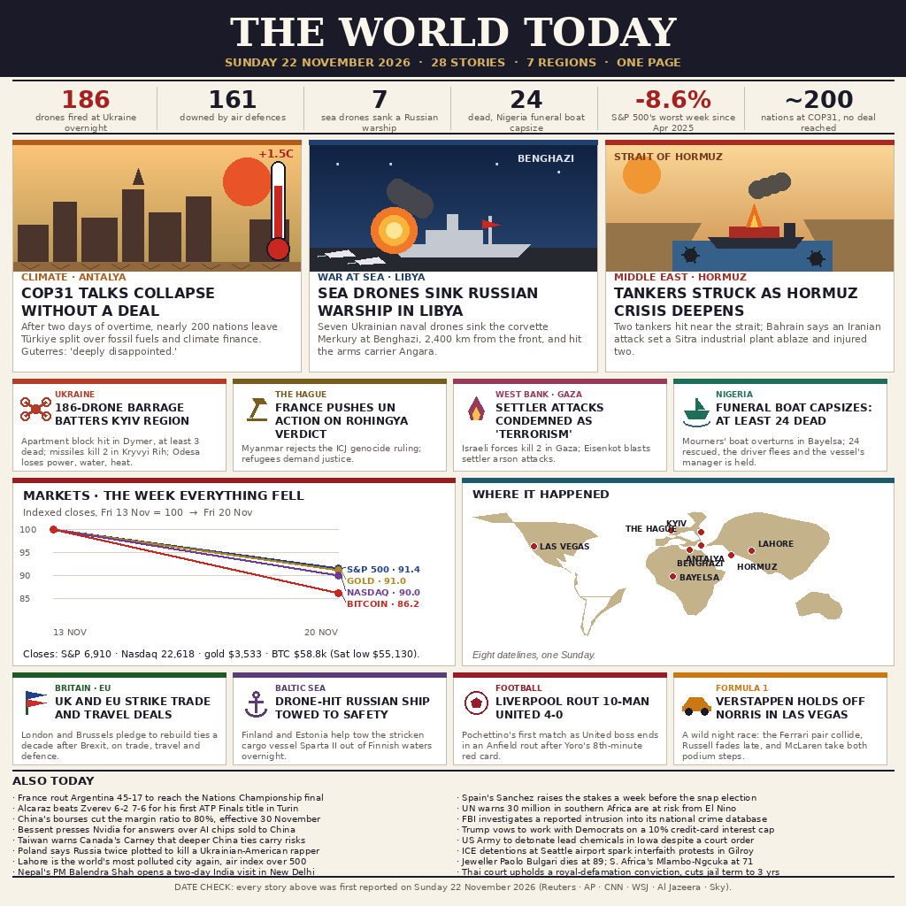
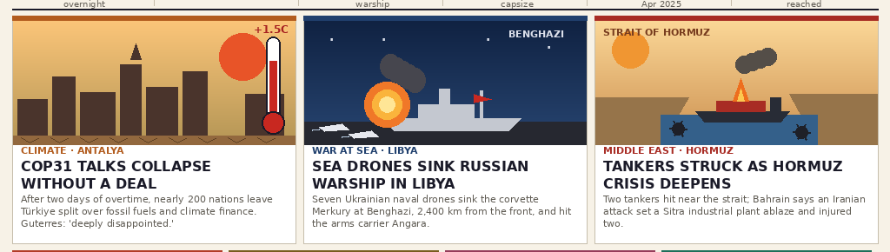
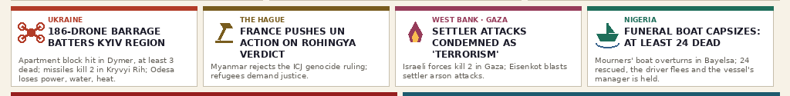
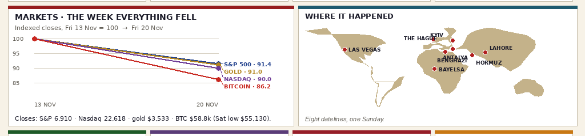
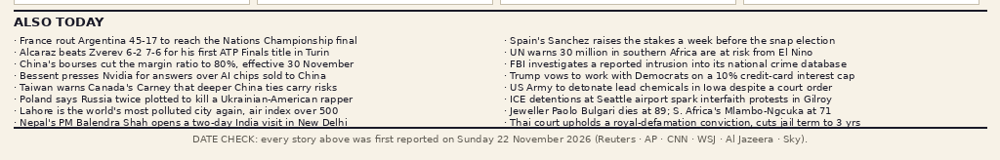

# The World Today: 22 November 2026 in One Image — 28 Stories, One Page

[](https://make.fun/bounty/news-image-20261122)
[](https://make.fun/bounty/news-image-20261122)
[](https://make.fun/bounty/news-image-20261122)



A whole day of world news drawn as a single front page: **28 verified stories** that were all first reported on **Sunday 22 November 2026**, researched from Reuters, AP, CNN, WSJ, Al Jazeera and Sky reporting of that day, and rendered programmatically with Python + Pillow — every letter crisp, every scene drawn, nothing pasted in.

## At a glance

| Part of the page | What it holds |
| --- | --- |
| Masthead | THE WORLD TODAY — Sunday 22 November 2026, 28 stories · 7 regions · one page |
| Stat strip | 186 drones fired at Ukraine · 161 downed · 7 sea drones · 24 dead in Nigeria · S&P 500 −8.6% week · ~200 nations at COP31 |
| Lead 1 — Climate | COP31 talks collapse in Antalya without a deal (skyline, sun and a +1.5C thermometer over cracked earth) |
| Lead 2 — War at sea | Seven Ukrainian sea drones sink the Russian corvette Merkury at Benghazi, Libya |
| Lead 3 — Middle East | Tankers struck as the Hormuz crisis deepens; Bahrain reports a Sitra plant ablaze |
| Small panels (8) | Ukraine barrage · Rohingya verdict fallout · West Bank attacks · Nigeria boat disaster · UK–EU deals · Baltic tow · Liverpool 4–0 United · Verstappen in Las Vegas |
| Markets | "The week everything fell": labelled line chart of indexed closes (13 Nov = 100 → 20 Nov) for the S&P 500, gold, Nasdaq and Bitcoin |
| World map | Continent-polygon map with 8 labelled dateline markers: Antalya, Benghazi, Kyiv, Hormuz, Bayelsa, The Hague, Las Vegas, Lahore |
| Also Today | 16 more one-line stories, from France's rugby rout to Lahore's smog |
| Footer | DATE CHECK: every story first reported on Sunday 22 November 2026, with sources named |

## Gallery

The three illustrated leads — a climate summit under a hot sun, a corvette burning in Benghazi harbour, a tanker alight in the Strait of Hormuz:



The news grid — eight small panels, each with its own drawn icon and regional colour accent:



Markets as a real chart, and the map of where it happened:



The Also Today list and the date-check footer:



## How it is built

- `generate_image.py` draws the whole page with Pillow (masthead, stat strip, three illustrated lead scenes, icon panels, the markets line chart and the continent-polygon map) and writes `entry.png` — 1024×1024, deterministic: two runs produce byte-identical output.
- `main.py` (Python 3.13, standard library only) copies `entry.png` to `$MAKEFUN_OUTPUT_DIR/entry.png` (or `/output/entry.png`), asserting the 1 MiB gate first.
- Every figure on the page was checked against that day's reporting before it was drawn: the 186/161 drone count is Ukraine's air force tally as reported Sunday; the market lines use verified Friday closes (13 and 20 November) from AP/NYSE reporting; the Las Vegas result is Sky Sports' classification.

## Verification

- `entry.png`: 1024×1024 PNG, 150,718 bytes (gate: ≤ 1 MiB), sha256 `4e1644bcb11ffdab7c6cb5218d01f0f311b4c70e093f91d78d0cc0f539c6ef8a`.
- Determinism: `generate_image.py` run twice → identical sha256; `main.py` run twice → both outputs identical to the committed `entry.png`.
- The page was proof-read at full size and at 256 px thumbnail size; masthead and lead headlines stay legible at thumbnail size.

## Run it

```sh
mkdir -p out && MAKEFUN_OUTPUT_DIR=out python3 main.py
```

---

Built for the make.fun bounty [Sum up 22 November's world news in one image](https://make.fun/bounty/news-image-20261122) · [@kangris-uk](https://make.fun/@kangris-uk)
